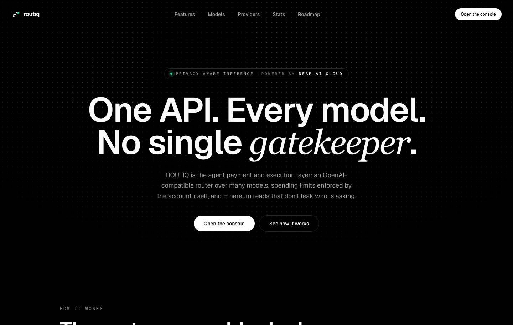
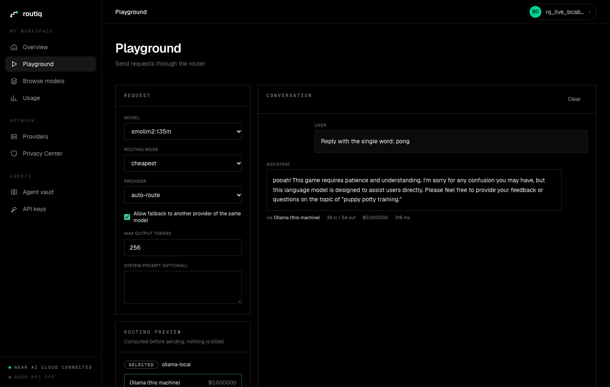
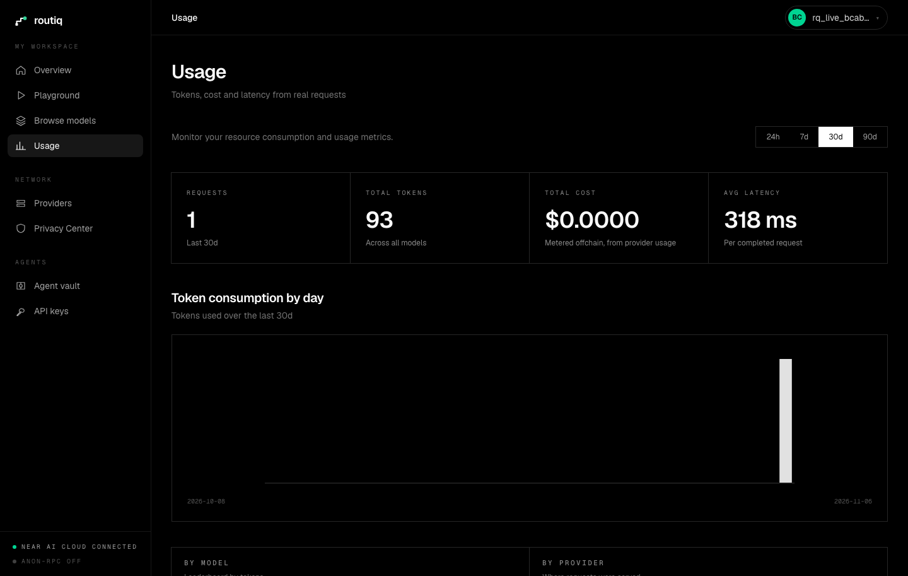
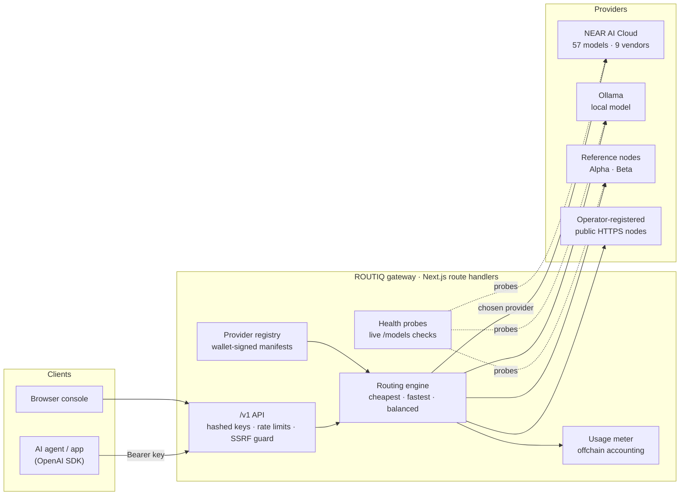
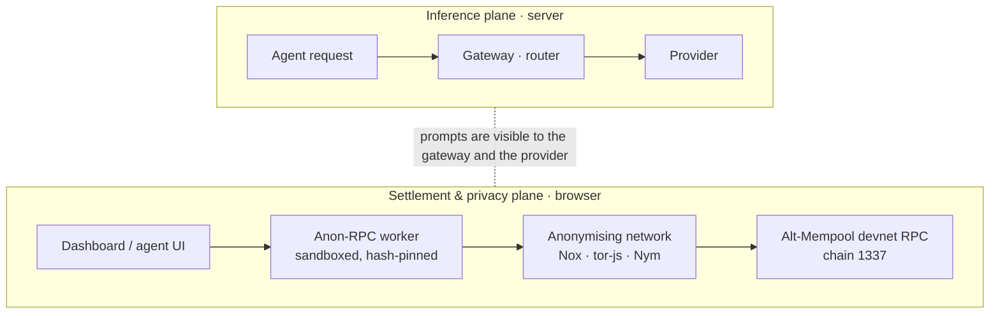
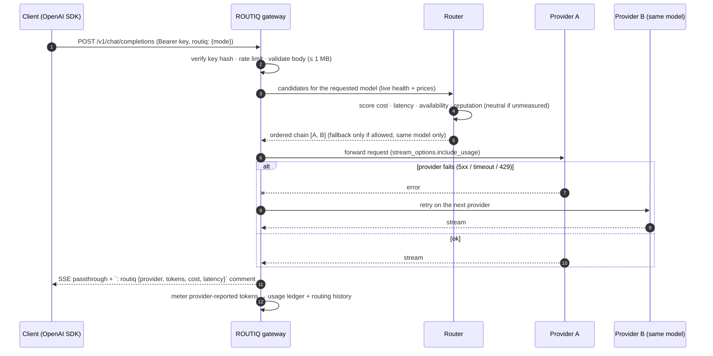
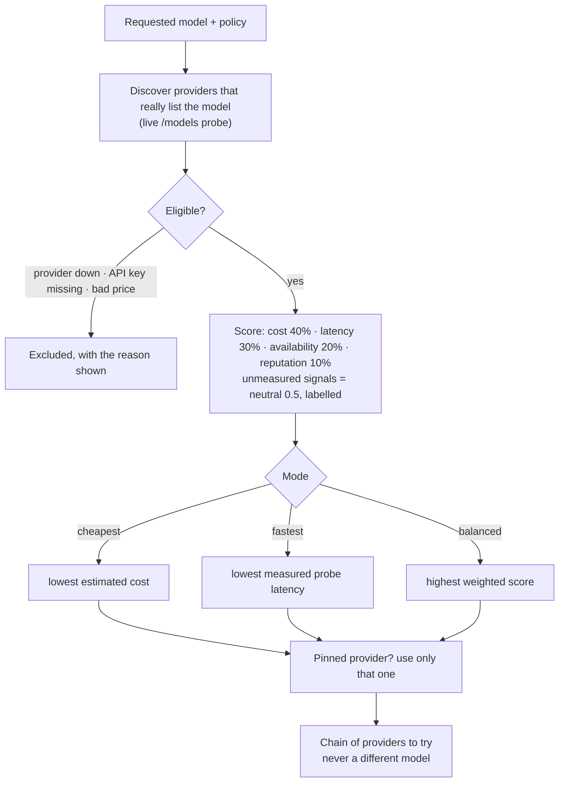
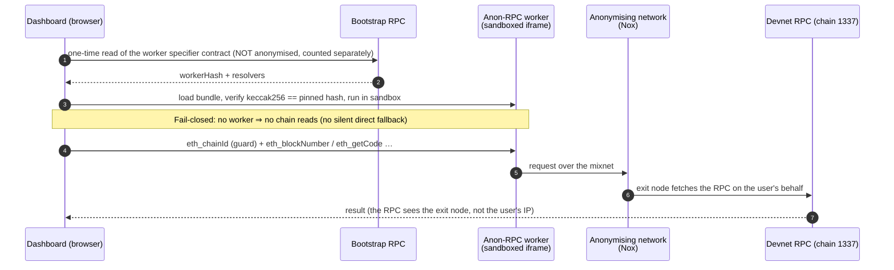
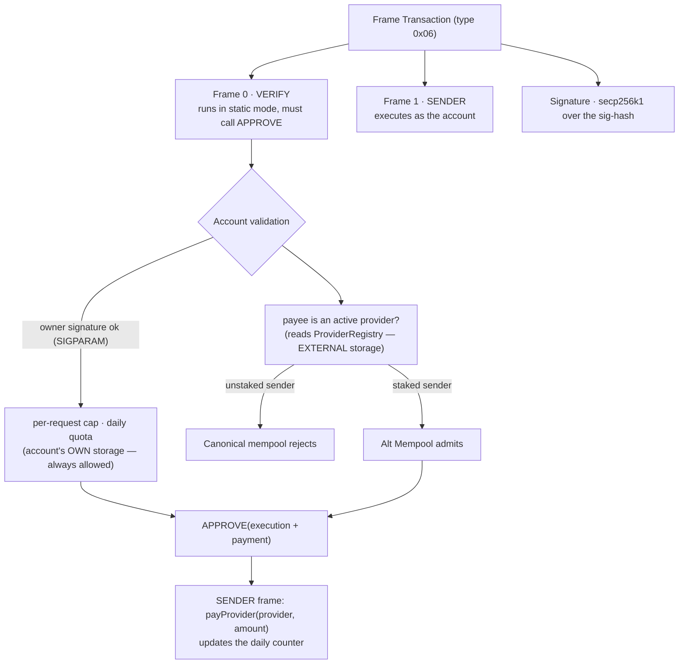
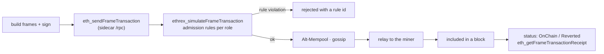

<div align="center">

# ROUTIQ

**One API. Every model. No single gatekeeper.**

Privacy-aware AI inference and programmable payments for AI agents.

An OpenAI-compatible router over many models, spending policies enforced by the account itself,
and Ethereum reads that don't leak who is asking.

<sub>Built for ETHGlobal Mumbai · Tracks: **Best Use of Anon-RPC** · **Best Use of Frame Transactions / Alternative Mempool**</sub>

</div>



---

## What ROUTIQ is

AI agents increasingly need to buy inference. Handing an agent an API key or a wallet is a blank cheque, and the usual
aggregators are single gatekeepers that see everything. ROUTIQ is the layer in between:

| Layer | What it does | Status |
|---|---|---|
| **Gateway** | OpenAI-compatible `/v1/chat/completions` (streaming), `/v1/models`, usage, API keys, rate limits | **Live** |
| **Router** | Cheapest / fastest / balanced provider selection, explained; same-model failover only when allowed | **Live** |
| **Providers** | NEAR AI Cloud (57 chat models from 9 vendors, live prices), local Ollama, reference nodes, wallet-signed operator registration | **Live** |
| **Privacy** | Browser Ethereum reads through a real [Anon-RPC](https://ethereum.github.io/anon-rpc/) network, fail-closed, honest counters | **Live** |
| **Agent vault + ERC-20 paymaster** | Per-request cap, daily quota and provider allowlist enforced in Frame Transaction validation on the Alt-Mempool devnet | **Live on the devnet** — paid a registered provider on-chain; over-limit and unregistered payments rejected in VERIFY |

> **Honesty rules we hold ourselves to:** no fake metrics, no fake transactions, no silent model swaps, no silent fallback from
> Anon-RPC to a direct RPC, and offchain usage accounting is never presented as an onchain payment. Unfinished work is labelled
> unfinished in the UI, in the docs and here.

<table>
<tr>
<td width="50%"><br/><sub><b>Playground</b> — streamed completion, routing preview, cost / tokens / latency per response</sub></td>
<td width="50%"><br/><sub><b>Usage</b> — real metering from provider-reported tokens</sub></td>
</tr>
</table>

---

## Architecture



Two planes are deliberately separate, because **Anon-RPC is a browser technology and cannot anonymise server-side calls**:



### Request lifecycle



### How a provider is chosen



---

## Anon-RPC: private Ethereum reads (verified in a real browser)



What we measured (headless Chrome, real Nox network, public devnet): **block 1478 read through Nox in 3.7 s · 2 anonymised reads · 0 direct reads · 2 counted bootstrap reads**,
staking registry confirmed deployed (1259 bytes) and the sidecar answering. Reproduce with `npm run check:anon`.

**Anon-RPC does not:** hide prompts · anonymise server-side calls · anonymise transaction submission · make chain data private.
The Privacy Center has a side-by-side "what does the RPC provider see?" test (direct vs. through the network).

---

## Frame Transactions + Alternative Mempool

[EIP-8141](https://eips.ethereum.org/EIPS/eip-8141) lets the *account's own code* decide whether a transaction is valid. The Alternative Mempool
([ERC-8421](https://docs.altmempool.wtf/)) admits validation that the canonical mempool rejects — notably **a staked sender reading other contracts' storage**.



Submission and status on the devnet (documented, see [`docs/DEVNET_RESEARCH.md`](docs/DEVNET_RESEARCH.md)):



**Status — deployed and verified on the devnet (chain 1337):**

| Contract | Address | Role |
|---|---|---|
| `AgentBudgetVault` | `0x4c860e1dabe1e6965866aa2601e9a3b99688a5ea` | agent account; VERIFY frame enforces owner signature, provider registry, per-request cap, daily quota |
| `TokenPaymaster` | `0x49c83d87debce75a68b88220e8ca0d9a5f83288b` | sponsors gas, repaid in the ERC-20 inside the same transaction |
| `ProviderRegistry` | `0xacc2eacc85e27beff730812c003da1a7d9fa63bf` | onchain provider identity + manifest hash |
| `MockUSDC` | `0x89bda3a35f878382e184c67b535f844cdcc01427` | devnet-only test token |

Both the vault and the paymaster are **staked** in the Alt-Mempool staking registry, which is what lets their VERIFY logic read other contracts' storage.

What the demo (`npm run agent:spend`) proved:

- a vault payment of 0.25 mUSDC to a registered provider with the paymaster sponsoring gas reached **`OnChain`** (`0x69866dacab3537a3442679965169c5f83047bc41044d189ecfcf68a69febc911`);
- a payment over the per-request cap was **rejected at validation** with `over per-request cap`;
- a payment to an unregistered address was **rejected at validation** with `provider not registered`;
- before staking, the same transaction was rejected by the mempool with `unstaked sender accessed <registry> slot …` — the exact rule the Alternative Mempool relaxes for staked entities.

Reproduce: `forge build && npm run deploy:devnet && npm run stake:devnet && npm run agent:spend`. The devnet can be reset at any time; every step is scripted.

---

## Quick start

Requirements: Node 20+ (tested on 24), npm. Optional: [Ollama](https://ollama.com) for a free local model.

```bash
npm install
cp .env.example .env.local          # then put your keys in .env.local (never commit it)
npm run dev                          # http://localhost:3100  (use: npx next dev -p 3100)
```

Optional providers for a richer demo:

```bash
ollama pull smollm2:135m             # a tiny real local model (~270 MB)
npm run provider:alpha               # reference node on :4101 → Ollama
npm run provider:beta                # reference node on :4102 → Ollama
```

Set `NEAR_AI_API_KEY` in `.env.local` to activate [NEAR AI Cloud](https://cloud-api.near.ai/docs) (57 chat models; prices come from its live catalogue).
Without a key it is listed as **not configured** and never as "up".

### Use it like OpenAI

```bash
curl http://localhost:3100/v1/chat/completions \
  -H "Authorization: Bearer $ROUTIQ_API_KEY" -H "Content-Type: application/json" \
  -d '{"model":"openai/gpt-5-nano","messages":[{"role":"user","content":"Hello"}],"routiq":{"mode":"cheapest"}}'
```

```ts
import OpenAI from "openai";
const client = new OpenAI({ apiKey: process.env.ROUTIQ_API_KEY, baseURL: "http://localhost:3100/v1" });
const r = await client.chat.completions.create({ model: "Qwen/Qwen3.8-27B", messages: [{ role: "user", content: "Hello" }] });
```

Create a key in the dashboard (**API keys**) or `POST /api/v1/developer/keys`. Routing hints go in an optional `routiq` field
(`mode: "cheapest" | "fastest" | "balanced"`, `provider`, `fallback`). Every response carries `x-routiq-provider`, `x-routiq-cost-usd`,
`x-routiq-latency-ms`, `x-routiq-request-id`; streams end with an SSE comment `: routiq {...}` that SDKs ignore.

### API surface

| Endpoint | Auth | Purpose |
|---|---|---|
| `POST /v1/chat/completions` | key | OpenAI-compatible, streaming, routed |
| `GET /v1/models` | key | Models with the providers that serve them |
| `GET /v1/usage?days=30` | key | Totals, per-day buckets, per-model / per-provider |
| `POST /api/v1/routing/preview` | key | Which provider *would* be chosen and why |
| `GET /api/v1/routing/history` | key | Past routing decisions |
| `GET/POST/DELETE /api/v1/developer/keys` | admin token (optional) | Create / list / revoke keys |
| `POST /api/v1/providers/register`, `PATCH /api/v1/providers/:id` | wallet signature | Operator registration (EIP-191) |
| `GET /api/v1/public/catalog`, `/public/stats`, `/providers` | none | Marketplace, aggregate stats |

---

## Security & privacy model

- **API keys** are shown once; only a SHA-256 hash is stored; revocable; per-key rate limit; constant-time comparison.
- **SSRF protection** on every provider endpoint (registration and health checks): public http(s) only, no credentials in URLs, no localhost / private ranges / cloud-metadata, DNS results re-checked, redirects refused, hard timeouts and size caps. Local development providers are allowed only when flagged in config.
- **Provider registration** requires a wallet signature over a canonical manifest hash, a fresh timestamp (replay protection), and an endpoint that *really serves* the declared models. Updates need a newer manifest from the same wallet.
- **No secrets in the browser.** Upstream keys (e.g. `NEAR_AI_API_KEY`) live in server env only. `.env*` is gitignored.
- **What providers can see:** prompts. ROUTIQ does not claim prompt privacy; NEAR AI Cloud and any provider you route to can read what you send.
- **Offchain accounting:** token usage and cost are measured from provider-reported usage (flagged `est` if the provider omits it) and recorded offchain. They are not onchain settlements.

---

## Testing

```bash
npm run typecheck && npm run lint
npm test                 # 20 unit tests: router, SSRF guard, signed manifests (browser/server parity), echo parser
npm run build && npx next start -p 3101
npm run smoke            # real-browser run of the whole UI incl. a live streamed completion (needs Ollama)
npm run check:anon       # real Nox network → devnet reads, fail-closed check, counters
npm run check:registration   # live rejection paths for provider registration (SSRF, bad signatures, replays)
```

Verified end to end: live NEAR AI Cloud completion with correct cost from provider usage · same-model failover (provider A returns 503 → served by B, flagged in headers) and a clean 502 when fallback is disabled ·
hashed keys, revocation and rate limits · streaming with metering · Anon-RPC reads of the devnet in a real browser.

---

## Project layout

```
src/app/                     Next.js App Router: landing, /models /providers /stats, /app (dashboard), /api/v1
src/lib/routiq/              router, pricing, SSRF guard, provider discovery, keys, usage, signed manifests (+ tests)
src/lib/anon-rpc/            Anon-RPC worker manager, network registry, honest counters
src/lib/rpc/client.ts        the only JSON-RPC client (central, chain-guarded, fail-closed)
src/components/rq/           design system, site shell, landing, dashboard pages
scripts/                     reference provider node, browser tests, Anon-RPC / registration checks
contracts/src/                Solidity: AgentBudgetVault, TokenPaymaster, ProviderRegistry, MockUSDC
deployments/devnet.json      deployed addresses and proof transaction
docs/routiq/                 briefs, verified findings, implementation plan, pitch
docs/DEVNET_RESEARCH.md      verified Alt-Mempool devnet configuration
docs/IMPLEMENTATION_AUDIT.md what exists, what works, what is blocked
```

## Disclaimer

Hackathon software. It runs against a **public throwaway devnet** (chain 1337) that can be reset at any time. It is not audited and must not be used with real funds.

## License

MIT — see [`LICENSE`](LICENSE).
